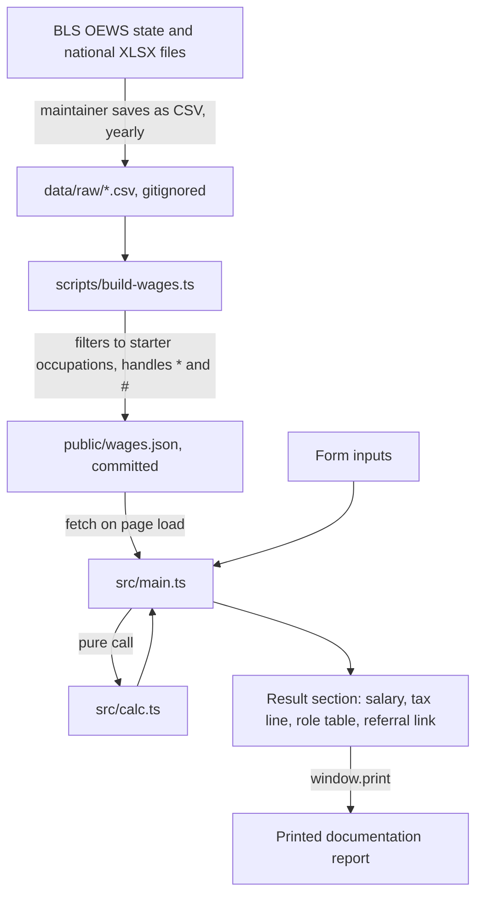
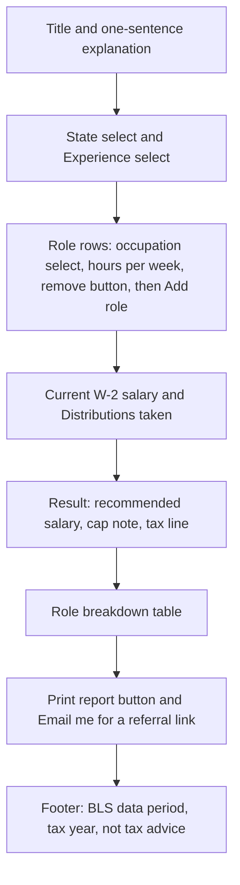

# S Corp Reasonable Salary Calculator - Plan

## Goal Capsule

- **Objective:** Ship a one-page static site on Vercel that estimates an S corp owner's reasonable salary with the cost approach, using state-level BLS wage data for every state, and prints a documentation report.
- **Authority:** Product Contract requirements win on behavior. Key Technical Decisions win on mechanism. Units override neither.
- **Execution profile:** Small greenfield TypeScript project. Windows dev machine with PowerShell, where `npm`/`npx` must be called as `npm.cmd`/`npx.cmd` (script execution policy blocks the `.ps1` shims).
- **Stop conditions:** Stop and ask if the BLS file lacks a column the data script needs, if a starter occupation code is missing from the BLS file and no clear replacement exists, or if a requirement conflicts with a KTD.
- **Tail ownership:** The executor builds, tests, and commits locally. Connecting the repo to Vercel needs the user's Vercel account, so U6 ends with a hand-off to the user for that step.

---

## Product Contract

### Summary

Build a static calculator page. The owner picks a state and experience level, lists the roles they fill with hours per week, and enters what they took out of the business. The page shows a recommended W-2 salary, a one-line payroll tax comparison, a referral email link, and a print-ready report. Wage data covers every state in the BLS OEWS state file for about 40 common owner occupations.

### Problem Frame

S corp owners must pay themselves reasonable compensation before taking distributions. The IRS gives factors, not a formula, and courts favor numbers backed by market wage data. Small-business owners usually fill several roles, so the IRS job aid's cost approach ("many hats") fits them: price each role at market rates and sum. Existing tools are mostly paid services or lead-capture forms. A free, transparent calculator that cites its data source gives owners a defensible starting number.

### Requirements

**Calculation**

- R1. Recommended salary is the sum over roles of: state hourly wage for the occupation at the chosen percentile × hours per week × 52.
- R2. Experience level Entry, Mid, and Senior selects the 25th, 50th, and 75th percentile wage.
- R3. Recommended salary is always the role total. When distributions are entered and cash taken (current salary plus distributions) is below it, a note says that if this is the full year, a W-2 salary equal to cash taken is enough. A blank field means not entered, not $0; current salary alone only feeds the tax comparison.
- R4. When BLS publishes no wage for an occupation in the chosen state, the calculation uses the national wage and labels that role as using the national rate.
- R5. The page shows payroll tax at the recommended salary and at the current salary, using 2026 rates: Social Security 12.4% on wages up to $184,500, Medicare 2.9% on all wages, and Additional Medicare 0.9% on wages over $200,000.

**Wage data**

- R6. Wage data covers every area in the BLS OEWS state file (50 states, DC, and territories) plus the national figures, for a fixed starter list of owner occupations.
- R7. The page and the report cite the BLS data period (May 2025 for the first release).

**Interface**

- R8. The interface is one page in one column. Results update as the user edits inputs, with no submit button.
- R9. The only inputs are: state, experience level, role rows (occupation and hours per week), current W-2 salary, and distributions taken this year.
- R10. Printing the page produces a documentation report: state, experience level, each role with SOC code, hours, rate, and cost, the recommended salary, data period, tax year, and print date.
- R11. An "Email me for a referral" `mailto:` link appears under the result.
- R12. A "not tax advice" disclaimer appears on the page and in the printed report.

**Code and deployment**

- R13. Calculation logic lives in a pure module with no DOM access. The page has no framework and no runtime dependencies.
- R14. The site deploys to Vercel Hobby from the repo with no Vercel-specific code.

### Acceptance Examples

- AE1. Cash-taken note shows. Covers R3.
  - **Given:** roles sum to $90,000; current salary $20,000; distributions $50,000.
  - **Then:** recommended salary shows the role total, with a note that a $70,000 W-2 is enough if that is the full year.
- AE2. National fallback. Covers R4.
  - **Given:** a state where BLS suppresses the wage for the chosen occupation.
  - **Then:** that role uses the national wage and its row is labeled as the national rate on screen and in print.
- AE3. Tax at the Social Security wage base. Covers R5.
  - **Given:** salary $190,000.
  - **Then:** payroll tax is $28,388 ($22,878 Social Security + $5,510 Medicare).
- AE4. Tax above the Additional Medicare threshold. Covers R5.
  - **Given:** salary $250,000.
  - **Then:** payroll tax is $30,578 ($22,878 + $7,250 + $450).

### Scope Boundaries

**Out of scope**

- Metro-area wages, multiple owners, and state payroll or unemployment taxes.
- The market and income approaches as separate methods.
- Saved sessions, accounts, shareable URLs, and analytics.
- A tax-year selector. Rates are one constant set per year.
- Health insurance treatment for 2% shareholders.
- Warnings based on salary as a percentage of profit. No IRS ratio exists.

#### Deferred to Follow-Up Work

- Display ads with a certified consent banner and a privacy page. Ads require Vercel Pro.
- Paid affiliate or referral links. These also make the site commercial under Vercel's Hobby terms.

---

## Planning Contract

### Key Technical Decisions

- KTD1. **Cost approach on a static page with a bundled wage snapshot.** No backend and no live BLS API calls. (session-settled: user-approved — chosen over a market-only approach or a backend: owners fill several roles, and a static page needs no server.) Governs R1, R13.
- KTD2. **Wage data is a committed JSON file built by a local script.** The maintainer downloads the BLS state and national XLSX files once a year, saves each as CSV, and runs the script. The script reads columns by header name and fails loudly on a missing column or occupation code. Saving as CSV avoids adding an XLSX parser dependency. (session-settled: user-approved — chosen over fetching BLS at Vercel build time: builds stay fast and do not depend on bls.gov.) Governs R6, R7.
- KTD3. **Plain `tsc`, browser ES modules, no bundler.** `tsc` compiles `src/` into `public/`. The tsconfig sets `rewriteRelativeImportExtensions`, `erasableSyntaxOnly`, and `verbatimModuleSyntax`, so source files import each other with `.ts` extensions and the same files run under Node's built-in type stripping for tests. These options need TypeScript 5.8 or later. `tsc` type-checks `src/` only. The yearly data script in `scripts/` runs under Node without a type check, which is acceptable for a maintainer-only tool. (session-settled: user-approved — chosen over Vite: one page does not need bundling or a dev server.) Governs R13.
- KTD4. **Experience level maps to a percentile.** Entry, Mid, and Senior map to the 25th, 50th, and 75th percentile. (session-settled: user-approved — chosen over always using the median: experience is an IRS factor.) Governs R2.
- KTD5. **One-line tax comparison.** (session-settled: user-approved — chosen over a table of salary scenarios: keeps the page simple.) Governs R5.
- KTD6. **Vercel Hobby, git-connected, framework preset "Other".** Vercel runs `npm run build` and serves `public/`, its default output directory when that folder exists, so no `vercel.json` is needed. This holds only while referrals are unpaid. Move to Vercel Pro or Cloudflare Pages before earning referral fees or client revenue from the site. (session-settled: user-directed — chosen over Vercel Pro and Cloudflare Pages: the referrals are unpaid, so the free plan's non-commercial rule is met.) Governs R14.
- KTD7. **Tests use `node:test` and `node:assert` with no test framework.** Node 24 runs `.ts` test files directly.
- KTD8. **One render path.** On any input event, `main.ts` reads the form, calls the pure calculation, and re-renders the result section. No state store and no incremental DOM patching.
- KTD9. **Hours are entered per week and annualized × 52.** This matches the BLS 2,080-hour work year (40 × 52) behind its annual figures. Native `min`/`max` attributes bound each role at 0–80 hours per week.
- KTD10. **The printed report is the result section itself.** A `@media print` block hides the form and buttons and shows a print-only header. There is no separate report generator.
- KTD11. **Tax constants live in the calculation module next to a `TAX_YEAR` constant.** Update them each January. The 2027 Social Security wage base ($192,300) is already published.
- KTD12. **BLS special values are handled in the data script.** A suppressed wage (`*`) becomes `null`, which triggers the R4 national fallback. A top-coded wage (`#`) is stored at the BLS threshold and flagged, and the report marks it as a minimum. A row with blank hourly percentiles but annual percentiles present is converted at annual ÷ 2,080.
- KTD13. **The referral email address is one constant in `main.ts`.** A plain `mailto:` link with a prefilled subject. It exposes the address to scrapers. Accept this until spam becomes a problem.

### High-Level Technical Design

Data flow from BLS to the page:



Page layout, top to bottom in one column:



### Wage data shape

The JSON maps area code to area name and wages. Each wage entry is the 25th, 50th, and 75th percentile hourly rate, or `null` when suppressed. Occupations map SOC code to title. Top-level fields record the BLS period and the top-code threshold. The implementer chooses the exact key names, keeping the file small and readable.

---

## Output Structure

```text
package.json            typescript devDependency; build, test, wages scripts
tsconfig.json           src -> public, strict, Node-compatible TS syntax
.gitignore              node_modules, public/*.js, data/raw/
README.md               run, test, yearly data refresh, deploy
public/index.html       page markup and the single style block, including print CSS
public/wages.json       generated wage snapshot, committed
src/calc.ts             pure calculation and payroll tax
src/calc.test.ts
src/main.ts             form reading, rendering, print, referral link
scripts/build-wages.ts  BLS CSV to wages.json
scripts/build-wages.test.ts
scripts/fixtures/       small CSV samples for the script test
```

The root `index.html`, `main.ts`, and `main.js` from the hello-world project are removed.

---

## Implementation Units

### U1. Project skeleton and toolchain

- **Goal:** Replace the hello-world files with the `src/` → `public/` layout and working build and test scripts.
- **Requirements:** R13, R14. KTD3, KTD6, KTD7.
- **Dependencies:** none.
- **Files:** `package.json`, `tsconfig.json`, `.gitignore`, `public/index.html` (placeholder), `src/main.ts` (placeholder). Delete root `index.html`, `main.ts`, `main.js`.
- **Approach:**
  1. Add `typescript` as the only devDependency. Scripts: `build` runs `tsc`, `test` runs `node --test` on explicit globs for `src/*.test.ts` and `scripts/*.test.ts`, and `wages` runs `node scripts/build-wages.ts`.
  2. Configure tsconfig per KTD3. Target ES2022 with ES module output and the DOM lib. Exclude `*.test.ts` from compilation so tests never land in `public/`.
  3. Load `main.js` from the page with `<script type="module">`.
- **Test expectation:** none -- scaffolding only.
- **Verification:** `npm run build` emits `public/main.js` with no errors.

### U2. Calculation module

- **Goal:** Pure functions for role cost, recommended salary with cap, and payroll tax.
- **Requirements:** R1, R2, R3, R4, R5, R13. KTD4, KTD9, KTD11.
- **Dependencies:** U1.
- **Files:** `src/calc.ts`, `src/calc.test.ts`.
- **Approach:**
  - Input is the parsed wage data plus a plain object of form values. Output is a result object: per-role rows (rate, source area, cost, top-coded flag), the uncapped total, the capped salary, a capped flag, and tax at the recommended and current salary.
  - Fallback to national lives in one lookup function that every role goes through (R4).
  - No DOM, no `fetch`, and no formatting. Currency formatting belongs to `main.ts`.
- **Test scenarios:**
  - Single role: rate $50/hr × 40 hr/wk → $104,000.
  - Two roles sum: $60/hr × 20 hr plus $25/hr × 20 hr → $88,400.
  - Experience Entry, Mid, and Senior pick the 25th, 50th, and 75th percentile from the same entry.
  - Covers AE1. Roles total $90,000 with $70,000 cash taken → $70,000, capped flag true.
  - Cash taken above the total → uncapped total, capped flag false.
  - Cash taken entered as zero with roles present → salary $0, capped flag true.
  - Both money fields blank with roles present → uncapped total, capped flag false.
  - Covers AE2. State entry `null` → national rate used, row source marked national.
  - State and national both `null` → role cost 0 and the row flagged as missing data, with no exception thrown.
  - No roles → salary 0, no exception.
  - Role with 0 hours contributes 0.
  - Covers AE3. Tax at $190,000 → $28,388.
  - Covers AE4. Tax at $250,000 → $30,578.
  - Tax at $0 → $0.
  - Tax exactly at $184,500 → Social Security portion $22,878.
- **Verification:** All scenarios pass under `npm test`.

### U3. Wage data script and first snapshot

- **Goal:** Convert BLS state and national CSV exports into `public/wages.json` and commit the May 2025 snapshot.
- **Requirements:** R4, R6, R7. KTD2, KTD12.
- **Dependencies:** U1.
- **Files:** `scripts/build-wages.ts`, `scripts/build-wages.test.ts`, `scripts/fixtures/state-sample.csv`, `scripts/fixtures/national-sample.csv`, `public/wages.json`.
- **Approach:**
  1. Download `oesm25st.zip` (state) and the matching national file from the BLS OEWS tables page. Open each XLSX in Excel, LibreOffice, or Google Sheets and save it as CSV into `data/raw/`.
  2. The starter occupation list lives in the script as SOC code → title, seeded from the Appendix.
  3. Parse CSV with a small quote-aware parser in the script. Strip a UTF-8 BOM and thousands separators.
  4. Look up columns by header name: area code, area title, occupation code, and the hourly and annual 25th, median, and 75th percentile columns. Exit with a clear error naming any missing column or starter code.
  5. Apply KTD12 for `*`, `#`, and annual-only rows.
  6. Write JSON with sorted keys so yearly diffs stay readable.
- **Test scenarios:**
  - Fixture row with numeric percentiles → three hourly numbers in output.
  - Quoted title containing a comma parses into the right columns.
  - `*` in a percentile → `null` for that entry.
  - `#` in the 75th percentile → threshold value with top-coded flag.
  - Hourly columns blank, annual present → annual ÷ 2,080.
  - Values with thousands separators parse correctly.
  - CSV with a BOM on the first header parses correctly.
  - Missing required column → error naming the column.
  - Starter code absent from the national file → error naming the code.
  - Occupations not in the starter list are dropped.
- **Verification:** Tests pass. Running `npm run wages` on the real exports produces `public/wages.json` with every area in the state file plus national, and the file size stays reasonable for a page load (well under 1 MB).

### U4. Calculator page

- **Goal:** The single-column form with live results.
- **Requirements:** R1, R2, R3, R4, R5, R8, R9. KTD8, KTD9.
- **Dependencies:** U2, U3.
- **Files:** `public/index.html`, `src/main.ts`.
- **Approach:**
  - Fetch `wages.json` once on load. Fill the state select from its areas and each occupation select from its occupations, both sorted by name.
  - Start with one empty role row. "Add role" clones a row. Each row has a remove button.
  - Any `input` or `change` event runs the KTD8 render path.
  - Results: the recommended salary in large type, the cap note when capped, the tax line when current salary is entered, and the role breakdown table. Top-coded and national-rate rows carry a short marker with a legend.
  - Format currency with `Intl.NumberFormat`.
  - Use native controls and labels. Every input has a `<label>`. The result region is an `aria-live="polite"` region so screen readers announce live updates.
- **Execution note:** Mostly DOM wiring over tested logic. Verify with a local browser smoke test, not unit tests.
- **Test scenarios:**
  - Fresh load with no state chosen → result area shows a prompt, no errors in the console.
  - Choose a state, one role at 40 hr/wk → salary matches the calc module for that rate.
  - Add a second role → total updates without a page action.
  - Remove a row → total updates.
  - Enter salary and distributions below the total → cap note appears.
  - Clear current salary → tax line hides.
  - Pick an occupation suppressed in a small state → row shows the national marker.
- **Verification:** All scenarios behave as described when served locally with `npx serve public` (module scripts and `fetch` do not work over `file://`).

### U5. Report, referral link, and disclaimer

- **Goal:** Print-ready report, referral email link, and footer citations.
- **Requirements:** R7, R10, R11, R12. KTD10, KTD13.
- **Dependencies:** U4.
- **Files:** `public/index.html`, `src/main.ts`.
- **Approach:**
  - The "Print report" button calls `window.print()`.
  - The print CSS hides the form, buttons, and referral link. It shows a print-only header with state, experience level, and print date. The role table adds SOC codes in print.
  - The referral link sits under the result. Its subject line names the tool.
  - The footer shows the BLS period from `wages.json`, the `TAX_YEAR` constant, and the not-tax-advice disclaimer. The disclaimer stays visible in print.
- **Test scenarios:**
  - Print preview shows the header, role table with SOC codes, salary, footer, and disclaimer, and hides inputs and buttons.
  - Print preview with a top-coded or national row keeps the marker and legend.
  - The referral link opens a mail client with the prefilled subject.
  - The footer period matches the period in `wages.json`.
- **Verification:** Browser print preview matches R10 and R12, checked in Chrome and one other browser.

### U6. README and Vercel deploy

- **Goal:** Document the yearly refresh and get the site live on Vercel Hobby.
- **Requirements:** R14. KTD2, KTD6, KTD11.
- **Dependencies:** U5.
- **Files:** `README.md`.
- **Approach:**
  - README covers local run, tests, the yearly data refresh steps from U3, the January tax-constant update, and the `npm.cmd`/`npx.cmd` note for PowerShell.
  - README states the Hobby non-commercial condition from KTD6 and when to move off it.
  - Deploy: push the repo to GitHub, import it in Vercel with framework preset "Other", and accept the default build command and output directory. This needs the user's GitHub and Vercel accounts, so the executor stops here and hands the steps to the user.
- **Test expectation:** none -- documentation and deployment configuration.
- **Verification:** The Vercel deployment URL loads, `wages.json` fetches, a state and role produce a salary, and print preview works on the live site.

---

## Risks & Dependencies

| Risk | Mitigation |
|---|---|
| BLS renames columns or changes the file layout in a future release | The script reads by header name and fails loudly. The yearly refresh is a manual, reviewed step. |
| Vercel treats the site as commercial | Keep referrals unpaid per KTD6. Move to Pro or Cloudflare Pages before earning from the site. |
| Users treat the number as tax advice | Disclaimer on page and in print (R12). Report cites the data source so a CPA can check it. |
| Spam to the referral address | Accepted per KTD13. Swap for a form service or obfuscation if it becomes a problem. |
| Tax constants go stale in January | KTD11 keeps them in one place. README lists the yearly update. |

---

## Open Questions

Deferred, non-blocking:

- The exact May 2025 top-code threshold. Read it from the BLS file's field notes during U3.
- The exact national file name for May 2025. Confirm on the BLS tables page during U3.
- Final occupation list. The Appendix list is a starting point. The user may add or drop occupations before the first snapshot.

---

## Verification Contract

Run `npm` and `npx` as `npm.cmd` and `npx.cmd` in PowerShell on this machine.

| Gate | Command | Applies to |
|---|---|---|
| Type check and build | `npm run build` | Every unit |
| Unit tests | `npm test` | U2, U3, and every later unit |
| Data regeneration | `npm run wages` | U3, and each yearly refresh |
| Local smoke test | `npx serve public`, then open the printed URL | U4, U5 |
| Live smoke test | Open the Vercel URL and repeat the U4 and U5 checks | U6 |

---

## Definition of Done

- All requirements R1–R14 are met and AE1–AE4 pass as unit tests.
- `npm run build` and `npm test` pass with no errors.
- `public/wages.json` is committed and covers every area in the BLS state file plus national.
- The hello-world root files are deleted.
- No runtime dependencies in `package.json`. `typescript` is the only devDependency.
- Dead-end or experimental code from abandoned approaches is removed from the diff.
- README covers run, test, yearly data refresh, tax-constant update, and deploy.
- The user has the Vercel deploy steps, or the site is live and passes the live smoke test.

---

## Appendix

### Starter occupation list

SOC codes from the 2018 SOC used by OEWS. U3 verifies each code exists in the BLS files.

- 11-1021 General and Operations Managers
- 11-2021 Marketing Managers
- 11-2022 Sales Managers
- 11-3031 Financial Managers
- 11-9021 Construction Managers
- 11-9111 Medical and Health Services Managers
- 13-1111 Management Analysts
- 13-1161 Market Research Analysts and Marketing Specialists
- 13-2011 Accountants and Auditors
- 13-2052 Personal Financial Advisors
- 15-1211 Computer Systems Analysts
- 15-1232 Computer User Support Specialists
- 15-1252 Software Developers
- 15-1254 Web Developers
- 17-1011 Architects, Except Landscape and Naval
- 17-2051 Civil Engineers
- 23-1011 Lawyers
- 23-2011 Paralegals and Legal Assistants
- 27-1024 Graphic Designers
- 27-3031 Public Relations Specialists
- 27-3043 Writers and Authors
- 27-4021 Photographers
- 29-1021 Dentists, General
- 29-1123 Physical Therapists
- 29-1131 Veterinarians
- 29-1141 Registered Nurses
- 29-1171 Nurse Practitioners
- 35-1011 Chefs and Head Cooks
- 37-3011 Landscaping and Groundskeeping Workers
- 39-5012 Hairdressers, Hairstylists, and Cosmetologists
- 39-9031 Exercise Trainers and Group Fitness Instructors
- 41-3091 Sales Representatives of Services, Except Advertising, Insurance, Financial Services, and Travel
- 41-9022 Real Estate Sales Agents
- 43-3031 Bookkeeping, Accounting, and Auditing Clerks
- 43-4051 Customer Service Representatives
- 43-6014 Secretaries and Administrative Assistants, Except Legal, Medical, and Executive
- 47-2031 Carpenters
- 47-2111 Electricians
- 47-2152 Plumbers, Pipefitters, and Steamfitters
- 49-9021 Heating, Air Conditioning, and Refrigeration Mechanics and Installers
- 53-3032 Heavy and Tractor-Trailer Truck Drivers

### Sources

- IRS, S corporation compensation and medical insurance issues: https://www.irs.gov/businesses/small-businesses-self-employed/s-corporation-compensation-and-medical-insurance-issues
- IRS, Reasonable Compensation Job Aid for IRS Valuation Professionals (cost, market, and income approaches): https://www.irs.gov/pub/irs-lbi/Reasonable%20Compensation%20Job%20Aid%20for%20IRS%20Valuation%20Professionals.pdf
- BLS OEWS data tables (May 2025 state file `oesm25st.zip`): https://www.bls.gov/oes/tables.htm
- SSA, 2026 contribution and benefit base: https://www.ssa.gov/oact/cola/cbb.html
- Vercel, vercel.json build command and output directory defaults: https://vercel.com/docs/project-configuration/vercel-json
- Vercel, Fair Use Guidelines (Hobby is non-commercial, ads count as commercial): https://vercel.com/docs/limits/fair-use-guidelines
